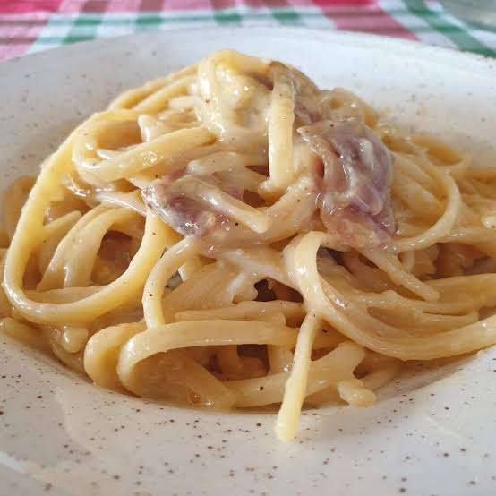

# Pasta

Espaguetis carbonara

## Ingredientes

| Ingrediente     | cantidad |
|-----------------|----------|
| espaguetis      |   200g   |
| pementa         |  gusto   |
| guanciale       |   100g   |
| ovos            | 3 yemas  |
| queixo          | 50g      |
| sal             | gusto    |

### Pasos

- Cociñar os **espaguetis** nunha olla con abundante auga

- Cortar o **guanciale** e doralo nunha sartén

- Batir as **yemas**,**queixo** e un pouco de **pementa** para facer a _salsa_

- Añadir _salsa_ e espaguetis a unha sartén

- `Emplatar`

>[Visita o meu blog](https://joelbaiotics.wordpress.com)

[🏠](index.md)
