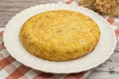

# Tortilla

tortilla recén feita

## Ingredientes

| Ingrediente     | cantidad |
|-----------------|----------|
| patacas         |   500g   |
| ovos            |    5     |
| sal             |  gusto   |
| aceite de oliva | abundante|

### Pasos

- Pelar **patacas** e cortalas en _láminas finas_

- Poñer **aceite** na sartén e añdir patacas

- Escurrir patacas

- Batir **ovos** e añadir **sal**

- En unha sartén con aceite añadimos as patacas e a mezcla de ovo.

- Esperar 2 minutos

- Dar volta a `tortilla` coa axuda dun plato

>[Visita o meu blog](https://joelrellan142.wordpress.com)

[🏠](index.md)
